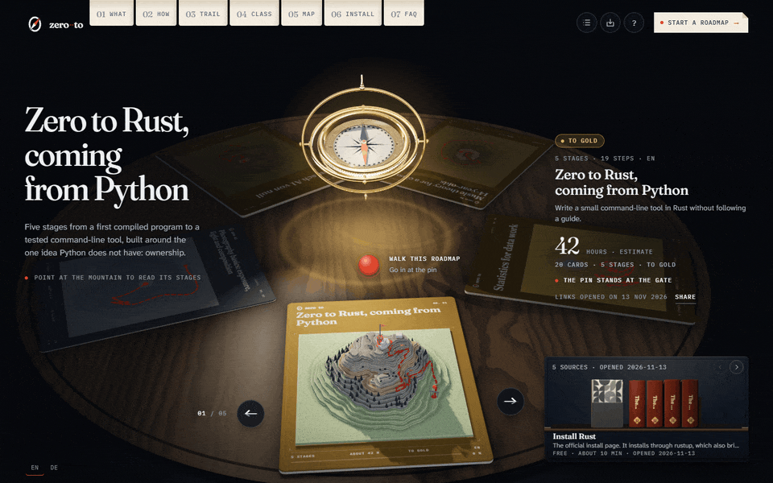
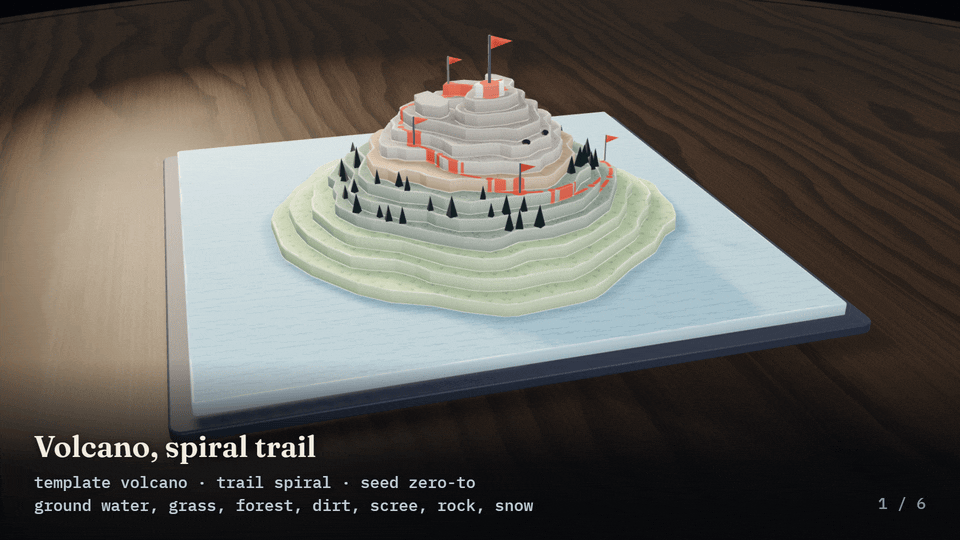

# zero-to

zero-to is an agent skill that turns one prompt into an interactive learning roadmap: a study plan with checked resources, drawn as a 3D trekking map.



*Recorded from the site: the example roadmap "Zero to Rust, coming from Python", from the table to the first steps of the walk.*

[Live site](https://othmanadi.github.io/zero-to/) | [Gallery](https://othmanadi.github.io/zero-to/gallery/) | [Install](#install) | [Roadmap format](.agents/skills/zero-to/references/roadmap-format.md)

## What it is

Type `/zero-to Rust` (or any other topic) in Claude Code, Codex or another agent that reads skills. The skill asks a few questions with ready answers to pick from, researches the topic, opens every resource link it wants to use and writes the result into one roadmap file. It then builds that file into a single HTML page that opens in your browser as a table of paper maps: your roadmap is a mountain, its stages are stretches of trail, every step is a waypoint with a note and a task, and every checkpoint is a signpost you pass.

It is for anyone learning on their own, for students next to a course, and for teachers who plan a unit for a class. The roadmap is a file on your disk. There is no account, and your progress stays in your browser.

## Install

```bash
npx skills add OthmanAdi/zero-to --skill zero-to
```

| Agent | Install | Invoke |
|---|---|---|
| Any agent, through the `skills` CLI | `npx skills add OthmanAdi/zero-to --skill zero-to` | `/zero-to` in Claude Code, `$zero-to` in Codex |
| Claude Code, as a plugin | `/plugin marketplace add OthmanAdi/zero-to`, then `/plugin install zero-to@zero-to` | `/zero-to:zero-to` |
| Any agent, by copying | Copy [`.agents/skills/zero-to`](.agents/skills/zero-to) into the agent's skills folder (Claude Code: `~/.claude/skills/zero-to`) | `/zero-to` |

Before the release, the `skills` CLI row (skills 1.8.1, telemetry off) was run against a local checkout in an empty folder. It installed the skill for Claude Code and Codex, and the installed copy validated a roadmap and built its page with no checkout nearby, which also covers the copy row. The plugin row was run with Claude Code 2.1.323 against the same checkout: the marketplace was added, the plugin installed and Claude Code listed it as enabled. Neither install has yet been followed by a `/zero-to` run in a new agent session, and the commands above that name `OthmanAdi/zero-to` were not run against GitHub before the repository was public.

The skill needs Node 22.12 or newer for its command-line tool, and web access for the research. You can also ask your agent to install it by reading [llms.txt](llms.txt).

## Use it

```text
/zero-to Rust for a Python developer. About 5 hours a week, I want to build a small command-line tool by spring.
/zero-to statistics, I can already use spreadsheets and want to read A/B test results without guessing.
/zero-to Bruchrechnung für meine 6. Klasse, 24 Schüler, zweimal pro Woche 45 Minuten, 6 Wochen, nur ein Beamer.
```

Anything the prompt already says is not asked again. The interview has at most three rounds of up to four questions (four rounds for a teacher), each with the recommended answer first. Add `--defaults` to skip the questions. Before the research starts, the agent prints a trip card with the total hours and a projected arrival date.

## What you get

1. Your roadmap lies on a turning table among the other roadmaps you have opened, under a brass compass that floats and turns in the light of a desk lamp. The lit sheet grows its mountain.
2. A red pin marks where you are. Click it and the camera dives into the map and lands at your current step, or at the gate if you have not started.
3. A walker follows the dashed trail up the paper mountain. Each waypoint opens a note card with what the step is for, a question to answer before you open the source, a hands-on task with its minutes, and up to four points to take with you into your field notebook.
4. Each stage ends at a signpost whose arms list what you should be able to show. You rate yourself there (saw it, did it with the guide, did it alone, could explain it), and the arms tick off as you pass.
5. The sources of the current step stand as books on a small shelf at the bottom right. Each one says when its link was opened and whether it is free.
6. An elevation strip under the map shows the whole route by hours, where you are on it, and when you will arrive at your pace.

The landscape comes from the roadmap. Six mountain shapes, five trail styles, eight kinds of ground and seven signposts can be chosen in the interview, or a seed picks them so that the same file always draws the same mountain.



*Recorded from the site: the six mountain shapes with their trails, then three seeded random landscapes.*


*Recorded from the site: the compass at the centre of the table, turning faster than it does on the site so that the loop closes in eight seconds.*

## Examples

Six roadmaps were written with the skill's method and are on the [live site](https://othmanadi.github.io/zero-to/gallery/). They cover a programming language, a framework, a school subject for a class, a craft, a spoken language and a field of mathematics. Their links were opened on 2026-11-13.

| Roadmap | Stages | Steps | Sources | Link check |
|---|---|---|---|---|
| [Zero to Rust, coming from Python](https://othmanadi.github.io/zero-to/roadmaps/rust-for-a-python-dev/) | 5 | 19 | 24 | 24 verified |
| [Zero to LangGraph, coming from Python](https://othmanadi.github.io/zero-to/roadmaps/langgraph-for-a-python-dev/) | 5 | 20 | 20 | 19 verified, 1 behind a sign-in |
| [Music theory for a class of 14-year-olds](https://othmanadi.github.io/zero-to/roadmaps/music-theory-for-a-class/) | 5 | 19 | 34 | 34 verified |
| [Photography basics: exposure, light and composition](https://othmanadi.github.io/zero-to/roadmaps/photography-basics/) | 2 | 11 | 12 | 12 verified |
| [Deutsch A1 von null](https://othmanadi.github.io/zero-to/roadmaps/deutsch-a1-von-null/) | 8 | 29 | 43 | 42 verified, 1 refused automated access |
| [Statistics for data work](https://othmanadi.github.io/zero-to/roadmaps/statistics-for-data-work/) | 6 | 23 | 37 | 37 verified |

## How resources are checked

The skill's tool opens every resource address (at most four at a time, 15 seconds each, up to five redirects) and records the HTTP status and the date in the roadmap file. A 200 only proves the address answers, so a source is marked verified only after the agent has read the page and found that it fits the step. A page behind a sign-in is marked gated, and a page that could not be read is marked unverified, each with a note that the site shows next to the source. When no source for a step could be checked, the step gets a gap line with search terms instead of an invented link.

Of the 170 sources in the six examples, 168 are verified, one is gated and one is unverified.

Links are checked when the roadmap is written and can break later. `/zero-to recheck <file>` opens them all again and updates the dates without changing the content.

## For teachers

Tell the skill who you teach and how often you meet, and the interview switches to its teacher branch: class size, session length, devices in the room. The roadmap gets a plan with one entry per session and tasks that fit the devices you have. `node scripts/zero-to.mjs student <file>` writes the copy you hand out, without your notes and session plans, and the site prints either one as a handout.

## Share and export

- A share link carries the whole roadmap in the address after `#r=`, so no server holds it. Whoever opens it sees a preview first.
- The built page is one HTML file that works offline.
- A Markdown export holds the roadmap and your field notebook, for notes, repositories or course pages.
- The print view makes a handout through the browser's print dialog.
- A calendar file (`.ics`) holds the class sessions, the next review of every finished step, your goal date and the planned arrival.

## The roadmap file

The site draws any valid roadmap, including one you write by hand. A step looks like this:

```json
{
  "id": "guessing-game",
  "title": "One whole program",
  "note": "A complete program before any theory: input, a loop, match, one external crate.",
  "predict": "Python lets you rebind any name. What will the Rust compiler say to: let x = 5; x = 6;",
  "do": "Type the guessing game yourself, no pasting. Then break it on purpose: remove one mut and read the error.",
  "takeaways": [
    "Variables are immutable by default; add mut to allow reassignment.",
    "match compares a value against patterns and must cover every case."
  ],
  "minutes": 120,
  "practiceMinutes": 90,
  "resources": ["book-guessing-game"]
}
```

The [format guide](.agents/skills/zero-to/references/roadmap-format.md) describes every field, the [JSON Schema](.agents/skills/zero-to/schema/roadmap.schema.json) checks them, and [map options](.agents/skills/zero-to/references/map-and-assets.md) lists the landscapes. The command-line tool next to the skill validates a file, checks its links, builds the page, prints a share link and writes the student copy: `node .agents/skills/zero-to/scripts/zero-to.mjs --help`.

## What it does not do

- It does not sync. Progress lives in one browser; a share link or the file carries a roadmap to another one.
- The quality of a roadmap depends on the agent's model and its web access. The skill can only check what the agent was able to open.
- The 3D view needs WebGL. Without it, or with `?view=list`, the site shows the roadmap as a plain page with the same content.
- The interface is in English and German. Roadmaps can be written in any language, but other scripts use the system fonts.
- The browser tests run in Chromium, on a 1280 by 800 desktop and on a Pixel 7 sized phone with touch, with a software renderer. Firefox and Safari are not covered, and frame times have not been measured on real graphics hardware.

## Commands

| Command | What it does |
|---|---|
| `npm run dev` | Development server on `127.0.0.1:5180` |
| `npm run build` | Type check, then a static build in `dist/` |
| `npm test` | Unit tests (Vitest with happy-dom) |
| `npm run test:e2e` | Browser tests (Playwright). Run `npx playwright install chromium` once first |
| `npm run check` | Type check, unit tests and build |
| `npm run og-images` | Social images for the gallery, after a build |
| `npm run prerender` | Gallery pages, sitemap and `robots.txt` in `dist/`. Set `SITE_ORIGIN` for a public build |
| `npm run build:viewer` | The single-file site the skill writes roadmaps into |

## How it came about and licence

The table, the dive into the map and the walk were designed after studying how an existing interactive map site moves. No code, artwork, text or asset of it is used here: the 3D scene was built from written notes and new art. [PROVENANCE.md](PROVENANCE.md) has the details, including the modules taken from Bookmark Bookshelf, an earlier project by the same author.

The licence is Apache-2.0 ([LICENSE](LICENSE), [NOTICE](NOTICE)). The 3D scene uses three.js under the MIT License, and the bundled typefaces are under the SIL Open Font License 1.1: see [THIRD_PARTY_NOTICES.md](THIRD_PARTY_NOTICES.md). Changes are in [CHANGELOG.md](CHANGELOG.md).
